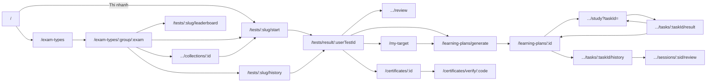

# Bản đồ URL frontend

Tổng hợp từ `app/[locale]/**/page.tsx`, [app/configs/Routes.ts](app/configs/Routes.ts), [proxy.ts](proxy.ts) và các chỗ gọi `Link href` / `router.push` / `router.replace` trong code (quét ngày 2026-10-25).

## Quy ước chung

- **Ngôn ngữ**: tiếng Việt không có tiền tố (`/exam-types`), tiếng Anh nằm dưới `/en` (`/en/exam-types`). Mọi URL bên dưới đều có bản `/en/...` tương ứng.
- **Đăng nhập**: [proxy.ts](proxy.ts) chặn các tiền tố `/admin`, `/albums`, `/certificates`, `/class`, `/classes`, `/dashboard`, `/learning-plans`, `/my-*`, `/practice`. Chưa đăng nhập thì chuyển sang `/login?from=<url cũ>&flash=...`.
  - Ngoại lệ mở cho khách: `/certificates/verify/**`, và đúng 3 trang `/learning-plans`, `/learning-plans/generate`, `/my-target` (khách xem được, bấm thao tác mới bắt đăng nhập).
  - Các layout `(user)`, `(user-focus)`, `(admin)`... còn bọc `AuthGuard` phía client: chưa đăng nhập → `/login?...`, không đủ quyền → `/not-found`.
- **Slug**: kỳ thi dùng `/exam-types/<nhóm>/<kỳ thi>` (vd `/exam-types/aws/saa-c03`). Link cũ `/exam-types/<uuid>` được proxy trả 308 sang slug. Bài thi dùng `/tests/<slug hoặc testId>/<start|history|leaderboard>`.
- **Không phải trang** (rewrite sang backend): `/api/*`, `/oauth2/authorization/*`, `/login/oauth2/*`.
- URL không khớp route nào → `[...rest]` → trang 404.

Ký hiệu cột "Truy cập": 🌐 công khai · 👤 cần đăng nhập · 👁 khách xem được, thao tác cần đăng nhập · 🔒 admin (theo quyền trong [adminPermissions.ts](app/configs/adminPermissions.ts)).

Cột "Ví dụ": slug kỳ thi/đề (`aws/saa-c03`, `aws-dop-c02-test-1`) và định dạng mã chứng chỉ (`EXAM-<năm>-<6 ký tự>`) lấy theo code thật; các UUID chỉ là giá trị minh hoạ, thay bằng id có trong database. Bản tiếng Anh thì thêm `/en` phía trước, vd `/en/exam-types/aws/saa-c03`.

---

## 1. Danh sách URL

### Công khai `(public)` — có Header/Footer

| URL | Trang | Truy cập | Ví dụ |
|---|---|---|---|
| `/` | Trang chủ (Hero, Certification Orbit, Rank Scope) | 🌐 | `/` |
| `/about` | Giới thiệu | 🌐 | `/about` |
| `/policy` | Chính sách | 🌐 | `/policy` |
| `/service` | Điều khoản dịch vụ | 🌐 | `/service` |
| `/coming-soon` | Sắp ra mắt | 🌐 | `/coming-soon` |
| `/exam-types` | Danh mục kỳ thi | 🌐 | `/exam-types` |
| `/exam-types/:group` | Nhóm kỳ thi / kỳ thi một cấp (danh sách đề, bộ đề) | 🌐 | `/exam-types/aws` · `/exam-types/toeic` |
| `/exam-types/:group/:exam` | Chi tiết kỳ thi (đề thi thử, bộ đề) | 🌐 | `/exam-types/aws/saa-c03` |
| `/exam-types/:group/collections/:collectionId` | Bộ đề thuộc kỳ thi một cấp | 🌐 | `/exam-types/toeic/collections/0b6d2f1e-3c4a-4e5b-8f7a-9c1d2e3f4a5b` |
| `/exam-types/:group/:exam/collections/:collectionId` | Bộ đề thuộc kỳ thi hai cấp | 🌐 | `/exam-types/aws/saa-c03/collections/0b6d2f1e-3c4a-4e5b-8f7a-9c1d2e3f4a5b` |
| `/posts` | Danh sách bài viết | 🌐 | `/posts` |
| `/posts/:postId` | Chi tiết bài viết | 🌐 | `/posts/2a7e4c9d-1b3f-4d6a-8e2c-5f9b0a1c3d4e` |
| `/resources` | Tài liệu ôn tập | 🌐 | `/resources` |
| `/certificates/verify` | Tra cứu chứng chỉ + tường chứng chỉ | 🌐 | `/certificates/verify` |
| `/certificates/verify/:code` | Kết quả xác minh chứng chỉ theo mã | 🌐 | `/certificates/verify/EXAM-2026-K7P3QX` |

### Xác thực `(auth)`

| URL | Trang | Truy cập | Ví dụ |
|---|---|---|---|
| `/login` | Đăng nhập / đăng ký (`?mode=signin\|signup`, `?from=`, `?flash=`, `?error=`) | 🌐 | `/login?mode=signup&from=/my-target` |
| `/forgot` | Quên mật khẩu | 🌐 | `/forgot` |
| `/reset` | Đặt lại mật khẩu (link từ email) | 🌐 | `/reset?token=<token trong email>` |
| `/oauth2/redirect` | Nhận kết quả đăng nhập Google/Facebook rồi chuyển tiếp | 🌐 (nằm trong `(user)` nhưng không bị proxy chặn) | `/oauth2/redirect` (backend tự chuyển về) |

### Trang trần `(bare)` — không Header/Footer

| URL | Trang | Truy cập | Ví dụ |
|---|---|---|---|
| `/resources/:resourceId` | Xem tài liệu phục hồi (recovery resource) | 🌐 | `/resources/6c8a1f3e-2d4b-4a7c-9e5f-0b1c2d3e4f5a` |
| `/not-found` | Trang 404 (AuthGuard đẩy về đây khi thiếu quyền) | 🌐 | `/not-found` |

### Khách & người dùng `(guest)`, `(guest-exam)`, `(guest-focus)` — khách vẫn làm bài được

| URL | Trang | Truy cập | Ví dụ |
|---|---|---|---|
| `/tests/:testId/start` | Làm bài thi (giao diện thi) | 🌐 | `/tests/aws-dop-c02-test-1/start` |
| `/tests/result/:userTestId` | Kết quả bài thi | 🌐 | `/tests/result/5e2f9c1a-7b3d-4e8a-9c6f-1d2b3a4c5e6f` |
| `/tests/result/:userTestId/review` | Xem lại đáp án (focus mode) | 🌐 | `/tests/result/5e2f9c1a-7b3d-4e8a-9c6f-1d2b3a4c5e6f/review` |
| `/learning-plans` | Trang trung chuyển "Lộ trình" (chỉ redirect, xem mục 3) | 👁 | `/learning-plans` |
| `/learning-plans/generate` | Sinh lộ trình học + danh sách lộ trình | 👁 | `/learning-plans/generate?userTestId=5e2f9c1a-7b3d-4e8a-9c6f-1d2b3a4c5e6f&examTypeId=9d4b2e7a-1c3f-4a5e-8b6d-2f0a1b3c4d5e` |
| `/my-target` | Đặt mục tiêu kỳ thi (`?examTypeId=`, `?next=`) | 👁 | `/my-target?examTypeId=9d4b2e7a-1c3f-4a5e-8b6d-2f0a1b3c4d5e` |

### Người dùng `(user)` — cần đăng nhập

| URL | Trang | Truy cập | Ví dụ |
|---|---|---|---|
| `/dashboard` | Hồ sơ / tổng quan cá nhân | 👤 | `/dashboard` |
| `/my-target/dashboard` | Bảng mục tiêu (`?examTypeId=`) | 👤 | `/my-target/dashboard?examTypeId=9d4b2e7a-1c3f-4a5e-8b6d-2f0a1b3c4d5e` |
| `/my-target/achieved` | Đã đạt mục tiêu | 👤 | `/my-target/achieved` |
| `/my-target/mocks` | Redirect sang `/my-target/dashboard` (giữ query) | 👤 | `/my-target/mocks` → `/my-target/dashboard` |
| `/learning-plans/compare` | So sánh các lộ trình | 👤 | `/learning-plans/compare` |
| `/learning-plans/:learningPlanId` | Chi tiết lộ trình | 👤 | `/learning-plans/3b7f1d2c-4e5a-4c6b-9d8e-0f1a2b3c4d5e` |
| `/learning-plans/:learningPlanId/tasks/:taskId/history` | Lịch sử làm một nhiệm vụ | 👤 | `/learning-plans/3b7f1d2c-4e5a-4c6b-9d8e-0f1a2b3c4d5e/tasks/8a1c3e5f-2b4d-4f6a-9c7e-1d2e3f4a5b6c/history` |
| `/tests/:testId/history` | Lịch sử làm đề | 👤 | `/tests/aws-dop-c02-test-1/history` |
| `/tests/:testId/leaderboard` | Bảng xếp hạng đề | 👤 | `/tests/aws-dop-c02-test-1/leaderboard` |
| `/my-certificates` | Chứng chỉ của tôi | 👤 | `/my-certificates` |
| `/certificates/:certificateId` | Chi tiết chứng chỉ | 👤 | `/certificates/4d9e2a7b-1f3c-4b5d-8e6a-2c0b1a3d4e5f` |
| `/my-albums` | Thẻ ghi nhớ của tôi *(đang ẩn khỏi menu)* | 👤 | `/my-albums` |
| `/albums/:albumId` | Chi tiết bộ thẻ *(đang ẩn)* | 👤 | `/albums/1e3a5c7d-9b2f-4d4e-8a6c-3f5b7d9e1a2c` |
| `/practice/:albumId` | Luyện bộ thẻ *(đang ẩn)* | 👤 | `/practice/1e3a5c7d-9b2f-4d4e-8a6c-3f5b7d9e1a2c` |
| `/my-classes` | Lớp học của tôi *(đang ẩn)* | 👤 | `/my-classes` |
| `/class/:classId/chapters` | Chương của lớp *(đang ẩn)* | 👤 | `/class/7f2b4d6e-8a1c-4e3f-9b5d-0c2e4a6b8d1f/chapters` |
| `/class/:classId/members` | Thành viên lớp *(đang ẩn)* | 👤 | `/class/7f2b4d6e-8a1c-4e3f-9b5d-0c2e4a6b8d1f/members` |
| `/classes/:classId/chapters/:chapterId/tests` | Bài thi của chương *(đang ẩn)* | 👤 | `/classes/7f2b4d6e-8a1c-4e3f-9b5d-0c2e4a6b8d1f/chapters/2c4e6a8b-1d3f-4a5c-9e7b-3d5f7a9c1e2b/tests` |
| `/admin/personal-question-bank` | Ngân hàng câu hỏi cá nhân *(đang ẩn)* | 👤 | `/admin/personal-question-bank` |
| `/admin/create-test-from-bank` | Tạo đề từ ngân hàng *(không có link nào trỏ tới)* | 👤 | `/admin/create-test-from-bank` |

### Người dùng – focus mode `(user-focus)` — không Header/Footer

| URL | Trang | Truy cập | Ví dụ |
|---|---|---|---|
| `/learning-plans/:learningPlanId/study` | Học nhiệm vụ (`?taskId=`) | 👤 | `/learning-plans/3b7f1d2c-4e5a-4c6b-9d8e-0f1a2b3c4d5e/study?taskId=8a1c3e5f-2b4d-4f6a-9c7e-1d2e3f4a5b6c` |
| `/learning-plans/:learningPlanId/tasks/:taskId/result` | Kết quả nhiệm vụ | 👤 | `/learning-plans/3b7f1d2c-4e5a-4c6b-9d8e-0f1a2b3c4d5e/tasks/8a1c3e5f-2b4d-4f6a-9c7e-1d2e3f4a5b6c/result` |
| `/learning-plans/:learningPlanId/sessions/:sessionId/review` | Xem lại một phiên học (`?taskId=`) | 👤 | `/learning-plans/3b7f1d2c-4e5a-4c6b-9d8e-0f1a2b3c4d5e/sessions/6b8d0f2a-3c5e-4a7b-9d1f-4e6a8c0b2d3f/review?taskId=8a1c3e5f-2b4d-4f6a-9c7e-1d2e3f4a5b6c` |

### Quản trị `(admin)` — layout có sidebar riêng

Tất cả 🔒, mỗi trang kiểm tra quyền riêng. URL admin không có tham số nên ví dụ chính là URL ở cột đầu, trừ trang bố cục: `/admin/exam-types/9d4b2e7a-1c3f-4a5e-8b6d-2f0a1b3c4d5e/layout`.

| URL | Trang |
|---|---|
| `/admin/dashboard` | Tổng quan |
| `/admin/analytics` | Phân tích |
| `/admin/users` | Người dùng |
| `/admin/roles` | Vai trò |
| `/admin/permissions` | Quyền |
| `/admin/exam-types` | Kỳ thi |
| `/admin/exam-types/:examTypeId/layout` | Bố cục giao diện thi của kỳ thi |
| `/admin/tags` | Thẻ (tag) |
| `/admin/exam-categories` | Danh mục kỳ thi |
| `/admin/exam-parts` | Phần thi |
| `/admin/skills` | Kỹ năng |
| `/admin/questions` | Câu hỏi |
| `/admin/question-collections` | Bộ câu hỏi |
| `/admin/scoring-conversion` | Quy đổi điểm |
| `/admin/milestones` | Mốc |
| `/admin/tests` | Đề thi |
| `/admin/recovery-resources` | Tài liệu phục hồi |
| `/admin/certificates` | Chứng chỉ |
| `/admin/categories` | Danh mục bài viết |
| `/admin/posts` | Bài viết |
| `/admin/evaluations` | Đánh giá |
| `/admin/coins` | Xu |
| `/admin/quests` | Nhiệm vụ |
| `/admin/cosmetics` | Vật phẩm trang trí |
| `/admin/streak-recover` | Khôi phục chuỗi |
| `/admin/emails` | Email |
| `/admin/audit-logs` | Nhật ký thao tác |
| `/admin/audit-login` | Nhật ký đăng nhập |

---

## 2. Điều hướng chung (có ở mọi trang dùng layout mặc định)

**Header** ([Header/index.tsx](app/components/layouts/Header/index.tsx))
- Logo → `/`
- Menu: Xác minh chứng chỉ `/certificates/verify` · Kỳ thi `/exam-types` · Tài liệu `/resources` · Bài viết `/posts` · Lộ trình `/learning-plans`
- Khách: Đăng nhập `/login?mode=signin&from=<trang hiện tại>` · Đăng ký `/login?mode=signup&from=...`
- Menu tài khoản: Hồ sơ `/dashboard` · Chứng chỉ của tôi `/my-certificates` · Cài đặt (modal, đổi ngôn ngữ = đổi tiền tố URL) · Đăng xuất → `/`
- Đang ẩn (comment): Thẻ ghi nhớ `/my-albums`, dropdown Lớp học `/my-classes`

**Thanh điều hướng mobile** ([MobileBottomNav](app/components/layouts/MobileBottomNav/index.tsx)) — ẩn trên `/login`, `/forgot`, `/reset`, `/oauth2`, `/admin`
- `/` · `/exam-types` · `/posts` · `/learning-plans` · menu thêm: `/resources`, `/dashboard`, `/my-certificates`, `/login?mode=signin|signup`

**Footer** ([Footer](app/components/layouts/Footer/index.tsx))
- `/` · `/exam-types` · `/learning-plans/generate` · `/about` · `/policy` · `/service`

**Trang 404** → `/`

---

## 3. Từ trang nào đi được tới đâu

### Công khai

| Từ | Đi tới |
|---|---|
| `/` (Hero) | `/exam-types`, `/coming-soon`; "Thi nhanh" → `/tests/:slug/start`; chưa có mục tiêu → `/my-target` hoặc `/learning-plans/generate`; khách → `/login?...` |
| `/` (Certification Orbit) | `/exam-types/:group/:exam`, `/learning-plans`, `/coming-soon` |
| `/` (Rank Scope) | `/exam-types` |
| `/coming-soon` | `/exam-types`, `/` |
| `/exam-types` | `/exam-types/:group[/:exam]` |
| `/exam-types/:group[/:exam]` | Bộ đề `.../collections/:collectionId` · Thẻ đề: Bắt đầu `/tests/:slug/start`, Lịch sử `/tests/:slug/history`, Xếp hạng `/tests/:slug/leaderboard` · Đặt mục tiêu `/my-target?examTypeId=` (khách → `/login`) · `/exam-types`, `/resources` |
| `.../collections/:collectionId` | Về kỳ thi `/exam-types/:group[/:exam]` · đề trong bộ → `/tests/:slug/start` |
| `/posts` | `/posts/:postId` |
| `/posts/:postId` | `/`, `/posts`, bài liên quan `/posts/:id` |
| `/certificates/verify` | Nhập mã → `/certificates/verify/:code` · tường chứng chỉ → `/certificates/verify/:code` |
| `/resources/:resourceId` | `/` |

### Xác thực

| Từ | Đi tới |
|---|---|
| `/login` | Thành công → URL trong `?from=` (mặc định `/`) · `/forgot` (form nội tuyến) · `/service`, `/policy` · Google/Facebook → `/oauth2/authorization/*` (backend) → `/oauth2/redirect` |
| `/oauth2/redirect` | Lỗi → `/login?error=...` · thành công → URL đã lưu trước khi đăng nhập (mặc định `/`) |
| `/forgot` | `/login` |
| `/reset` | Thành công → `/login` · `/forgot` |

### Làm bài & kết quả

| Từ | Đi tới |
|---|---|
| `/tests/:testId/start` | Nộp bài / hết giờ → `/tests/result/:userTestId` · link bằng id được đổi sang `/tests/:slug/start` |
| `/tests/result/:userTestId` | Xem lại → `/tests/result/:userTestId/review` (bảng phân tích tag → `.../review#rq-<questionId>`) · Lịch sử → `/tests/:testId/history` · Gauge sẵn sàng → `/exam-types/:examTypeId` · Tạo lộ trình → `/learning-plans/generate?userTestId=&examTypeId=` (chưa có mục tiêu → `/my-target?examTypeId=&next=...`) · Chứng chỉ → `/certificates/:certificateId`, `/learning-plans/generate` · Khách lưu bài → `/login?...` · Về `/` |
| `/tests/result/:userTestId/review` | `/tests/result/:userTestId`, `/` |
| `/tests/:testId/history` | Tab (header đề): `/exam-types`, kỳ thi, `/tests/:slug/history`, `/tests/:slug/leaderboard`, `/tests/:slug/start` · lượt làm → `/tests/result/:userTestId` |
| `/tests/:testId/leaderboard` | Tab giống trang lịch sử |

### Mục tiêu & lộ trình

| Từ | Đi tới |
|---|---|
| `/learning-plans` (trung chuyển) | Khách → `/my-target` · có query → `/learning-plans/generate?...` · có lộ trình ACTIVE → `/learning-plans/:newestId` · chưa có → `/learning-plans/generate` |
| Tab mục tiêu/lộ trình (dùng chung) | `/my-target` · `/learning-plans/generate` · `/learning-plans/compare` · `/my-target/dashboard` |
| `/my-target` | Lưu xong → `?next=` hoặc `/learning-plans/generate?examTypeId=` · khách bấm lưu → `/login` |
| `/learning-plans/generate` | Tạo xong → `/learning-plans/:id` · khách → `/login` · `/exam-types`, kỳ thi nguồn · `/my-target?...` · danh sách: `/learning-plans/:id`, `/learning-plans/:id#chon-ai-hoc`, `/learning-plans/compare` |
| `/my-target/dashboard` | `/my-target`, `/my-target/achieved`, `/learning-plans/:activeId`, `/learning-plans/generate?userTestId=` · lịch sử thi thử → `/tests/result/:userTestId`, `/` |
| `/my-target/achieved` | `/my-target/dashboard`, `/my-target`, `/learning-plans/compare`, `/` |
| `/learning-plans/compare` | `/learning-plans/generate`, `/tests/result/:sourceUserTestId`, `/learning-plans/:id`, `/learning-plans/:id/study` |
| `/learning-plans/:id` | `/learning-plans/:id/study?taskId=` · nhiệm vụ: `.../tasks/:taskId/history`, `.../tasks/:taskId/result` · lộ trình thay thế `/learning-plans/:replacedById` · `/learning-plans/generate[?examTypeId=&userTestId=]` · kỳ thi `/exam-types/...` |
| `/learning-plans/:id/study` | Xong nhiệm vụ → `.../tasks/:taskId/result` · thoát → `/learning-plans/:id` · kỳ thi `/exam-types/...` |
| `.../tasks/:taskId/result` | `/learning-plans/:id` · làm lại / nhiệm vụ tiếp → `/learning-plans/:id/study?taskId=` |
| `.../tasks/:taskId/history` | `/learning-plans/:id`, `/learning-plans/:id/study?taskId=`, `.../sessions/:sessionId/review?taskId=` |
| `.../sessions/:sessionId/review` | `.../tasks/:taskId/history`, `/learning-plans/:id`, `/learning-plans/:id/study?taskId=` |

### Cá nhân

| Từ | Đi tới |
|---|---|
| `/dashboard` | Lối tắt: `/exam-types`, `/learning-plans`, `/resources`, `/my-certificates` · thẻ mục tiêu: `/my-target`, `/my-target/dashboard?examTypeId=`, `/learning-plans/generate?examTypeId=` · bài viết của tôi/đã lưu → `/posts/:postId` · (ẩn: `/my-albums`, `/my-classes`, `/admin/personal-question-bank`) |
| `/my-certificates` | `/certificates/:certificateId`, `/certificates/verify/:code`, `/` |
| `/certificates/:certificateId` | `/certificates/verify/:code`, `/my-certificates` |
| `/my-albums` *(ẩn)* | `/albums/:albumId` |
| `/albums/:albumId` *(ẩn)* | `/practice/:albumId` |
| `/my-classes` *(ẩn)* | `/class/:classId/chapters`, `/class/:classId/members` |
| `/class/:classId/chapters` *(ẩn)* | `/classes/:classId/chapters/:chapterId/tests` |
| Modal tạo đề (Header, chỉ ADMIN) | → `/admin/personal-question-bank` |

### Quản trị

| Từ | Đi tới |
|---|---|
| Sidebar admin | Tất cả 28 trang `/admin/*` ở mục 1 · về `/` · về `/dashboard` |
| `/admin/exam-types` | `/admin/exam-types/:examTypeId/layout` |
| `/admin/posts` | Xem bài `/posts/:postId` |
| Lối vào khu admin | Không có link từ giao diện người dùng — gõ thẳng `/admin/dashboard` |

---

## 4. Luồng chính

Luồng khách: làm bài → kết quả → "Lưu / tạo lộ trình" → `/login?mode=signup&from=/my-target?examTypeId=..&next=/learning-plans/generate?userTestId=..` → đặt mục tiêu → sinh lộ trình (bài vừa làm được gắn vào tài khoản sau khi đăng nhập).

---

## 5. Ghi chú

- **Trang không có link nào trỏ tới**: `/admin/create-test-from-bank`, `/my-target/mocks` (chỉ còn để redirect link cũ), cả khu `/admin/*` (vào bằng gõ URL).
- **Trang đang ẩn lối vào** (link bị comment, trang vẫn chạy nếu gõ URL): thẻ ghi nhớ (`/my-albums`, `/albums/*`, `/practice/*`), lớp học (`/my-classes`, `/class/*`, `/classes/*`), `/admin/personal-question-bank`.
- `PROTECTED_PREFIXES` trong [proxy.ts](proxy.ts) có `/tests/history` và `/tests/leaderboard`, nhưng URL thật là `/tests/:testId/history` nên proxy không chặn; hai trang này chỉ được bảo vệ bởi `AuthGuard` của layout `(user)` ở phía client.
- Trang SEO: [sitemap.ts](app/sitemap.ts) liệt kê `/`, `/about`, `/posts`, `/policy`, `/service`, `/certificates/verify`, `/exam-types` và từng trang kỳ thi; [robots.ts](app/robots.ts) chặn `/admin/`, `/my-*`, `/learning-plans/`, `/tests/`, `/dashboard`, `/oauth2/`.
