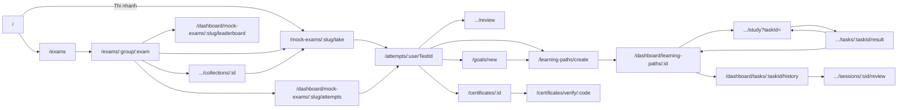

# Bản đồ URL frontend

Chỉ liệt kê những trang **đang có lối vào trên giao diện** (menu, nút, link, hoặc chuyển trang tự động). Trang vẫn còn code nhưng link đã bị comment/ẩn thì không đưa vào bảng, xem danh sách ở [mục 5](#5-trang-còn-code-nhưng-đang-ẩn).

Tổng hợp từ `app/[locale]/**/page.tsx`, [app/configs/Routes.ts](app/configs/Routes.ts), [proxy.ts](proxy.ts) và các chỗ gọi `Link href` / `router.push` / `router.replace` sau khi đã bỏ phần code bị comment (quét ngày 2026-10-25).

## Quy ước chung

- **Ngôn ngữ**: tiếng Việt không có tiền tố (`/exams`), tiếng Anh nằm dưới `/en` (`/en/exams`). Mọi URL bên dưới đều có bản `/en/...` tương ứng.
- **Đăng nhập**: [proxy.ts](proxy.ts) chặn các tiền tố `/admin`, `/dashboard`, `/albums`, `/class(es)`, `/my-albums`, `/my-classes`, `/practice`. Chưa đăng nhập thì chuyển sang `/login?from=<url cũ>&flash=...`.
  - Trang khách xem được, bấm thao tác mới bắt đăng nhập, nằm ngoài các tiền tố trên: `/learning-paths`, `/learning-paths/create`, `/goals/new`, làm bài `/mock-exams/:id/take`, kết quả `/attempts/:id`.
  - Các layout `(user)`, `(user-focus)`, `(admin)`... còn bọc `AuthGuard` phía client: chưa đăng nhập → `/login?...`, không đủ quyền → `/404`.
- **URL cũ** (308, khai trong [next.config.mjs](next.config.mjs)): `/my-target` → `/goals/new`; `/my-target/dashboard|mocks|achieved` → `/dashboard/goals[/achieved]`; `/learning-plans` → `/learning-paths`, `/learning-plans/generate` → `/learning-paths/create`, `/learning-plans/:id/**` → `/dashboard/learning-paths/:id/**`, `/dashboard/learning-paths/:id/tasks/:taskId/history` → `/dashboard/tasks/:taskId/history`; `/tests/:id/start` → `/mock-exams/:id/take`; `/tests/result/:id[/review]` → `/attempts/:id[/review]`; `/tests/:id/history|leaderboard` → `/dashboard/mock-exams/:id/attempts|leaderboard`; `/my-certificates`, `/certificates/:id` → `/dashboard/certificates[/:id]`; `/admin/personal-question-bank` → `/dashboard/question-bank`, `/admin/create-test-from-bank` → `/dashboard/question-bank/create-test`; `/exam-types/**` → `/exams/**`, `/policy` → `/privacy-policy`, `/service` → `/terms`, `/forgot` → `/forgot-password`.
- **Slug**: kỳ thi dùng `/exams/<nhóm>/<kỳ thi>` (vd `/exams/aws/saa-c03`). Link cũ `/exams/<uuid>` được proxy trả 308 sang slug. Mã kỳ thi ở trang mục tiêu/lộ trình là slug nhóm + slug kỳ thi: `/dashboard/goals/aws-saa-c03`, `?exam=aws-saa-c03`. Đề dùng slug hoặc testId: `/mock-exams/<đề>/take`, `/dashboard/mock-exams/<đề>/attempts|leaderboard`. Trang tạo lộ trình nhận bài nguồn qua `?attempt=<userTestId>` (link cũ `?userTestId=` vẫn đọc được).
- **Không phải trang** (rewrite sang backend): `/api/*`, `/oauth2/authorization/*`, `/login/oauth2/*`.
- URL không khớp route nào → trang 404 (giữ nguyên URL). Trang 404 cũng có URL riêng `/404` (trả mã 404, tiêu đề "404 | FrostScope"); `/not-found` cũ không còn.

Ký hiệu cột "Truy cập": 🌐 công khai · 👤 cần đăng nhập · 👁 khách xem được, thao tác cần đăng nhập · 🔒 admin (theo quyền trong [adminPermissions.ts](app/configs/adminPermissions.ts)).

Cột "Ví dụ": slug kỳ thi/đề (`aws/saa-c03`, `aws-dop-c02-test-1`) và định dạng mã chứng chỉ (`EXAM-<năm>-<6 ký tự>`) lấy theo code thật; các UUID chỉ là giá trị minh hoạ, thay bằng id có trong database. Bản tiếng Anh thì thêm `/en` phía trước, vd `/en/exams/aws/saa-c03`.

---

## 1. Danh sách URL

### Công khai `(public)` — có Header/Footer

| URL | Trang | Truy cập | Ví dụ |
|---|---|---|---|
| `/` | Trang chủ (Hero, Certification Orbit, Rank Scope) | 🌐 | `/` |
| `/about` | Giới thiệu | 🌐 | `/about` |
| `/contact` | Liên hệ (email hợp tác, tư vấn, khiếu nại) | 🌐 | `/contact` |
| `/privacy-policy` | Chính sách | 🌐 | `/privacy-policy` |
| `/terms` | Điều khoản dịch vụ | 🌐 | `/terms` |
| `/coming-soon` | Sắp ra mắt (nhà cung cấp chưa có đề) | 🌐 | `/coming-soon?provider=azure` |
| `/exams` | Danh mục kỳ thi | 🌐 | `/exams` |
| `/exams/:group` | Nhóm kỳ thi / kỳ thi một cấp (danh sách đề, bộ đề) | 🌐 | `/exams/aws` · `/exams/toeic` |
| `/exams/:group/:exam` | Chi tiết kỳ thi (đề thi thử, bộ đề) | 🌐 | `/exams/aws/saa-c03` |
| `/exams/:group/collections/:collectionId` | Bộ đề thuộc kỳ thi một cấp | 🌐 | `/exams/toeic/collections/0b6d2f1e-3c4a-4e5b-8f7a-9c1d2e3f4a5b` |
| `/exams/:group/:exam/collections/:collectionId` | Bộ đề thuộc kỳ thi hai cấp | 🌐 | `/exams/aws/saa-c03/collections/0b6d2f1e-3c4a-4e5b-8f7a-9c1d2e3f4a5b` |
| `/resources` | Tài liệu ôn tập | 🌐 | `/resources` |
| `/certificates/verify/:code` | Xác minh chứng chỉ theo mã (kèm ô tra cứu + tường chứng chỉ) | 🌐 | `/certificates/verify/EXAM-2026-K7P3QX` |
| `/posts/:postId` | Chi tiết bài viết (chỉ mở từ trang admin Bài viết) | 🌐 | `/posts/2a7e4c9d-1b3f-4d6a-8e2c-5f9b0a1c3d4e` |

### Xác thực `(auth)`

| URL | Trang | Truy cập | Ví dụ |
|---|---|---|---|
| `/login` | Đăng nhập / đăng ký (`?mode=signin\|signup`, `?from=`, `?flash=`, `?error=`) | 🌐 | `/login?mode=signup&from=/goals/new` |
| `/forgot-password` | Quên mật khẩu | 🌐 | `/forgot-password` |
| `/reset` | Đặt lại mật khẩu (link từ email) | 🌐 | `/reset?token=<token trong email>` |
| `/oauth2/redirect` | Nhận kết quả đăng nhập Google/Facebook rồi chuyển tiếp | 🌐 | `/oauth2/redirect` (backend tự chuyển về) |

### Trang trần `(bare)` — không Header/Footer

| URL | Trang | Truy cập | Ví dụ |
|---|---|---|---|
| `/resources/:resourceId` | Xem tài liệu phục hồi (mở từ trang học lộ trình) | 🌐 | `/resources/6c8a1f3e-2d4b-4a7c-9e5f-0b1c2d3e4f5a` |

### Khách & người dùng `(guest)`, `(guest-exam)`, `(guest-focus)` — khách vẫn làm bài được

| URL | Trang | Truy cập | Ví dụ |
|---|---|---|---|
| `/mock-exams/:testId/take` | Làm bài thi (giao diện thi) | 🌐 | `/mock-exams/aws-dop-c02-test-1/take` |
| `/attempts/:userTestId` | Kết quả bài thi | 🌐 | `/attempts/5e2f9c1a-7b3d-4e8a-9c6f-1d2b3a4c5e6f` |
| `/attempts/:userTestId/review` | Xem lại đáp án (focus mode) | 🌐 | `/attempts/5e2f9c1a-7b3d-4e8a-9c6f-1d2b3a4c5e6f/review` |
| `/learning-paths` | Trang trung chuyển "Lộ trình" (chỉ redirect, xem mục 3) | 👁 | `/learning-paths` |
| `/learning-paths/create` | Sinh lộ trình học + danh sách lộ trình | 👁 | `/learning-paths/create?attempt=5e2f9c1a-7b3d-4e8a-9c6f-1d2b3a4c5e6f&examTypeId=9d4b2e7a-1c3f-4a5e-8b6d-2f0a1b3c4d5e` |
| `/goals/new` | Đặt mục tiêu kỳ thi (`?examTypeId=`, `?next=`) | 👁 | `/goals/new?examTypeId=9d4b2e7a-1c3f-4a5e-8b6d-2f0a1b3c4d5e` |

### Người dùng `(user)` — cần đăng nhập

| URL | Trang | Truy cập | Ví dụ |
|---|---|---|---|
| `/dashboard` | Hồ sơ / tổng quan cá nhân | 👤 | `/dashboard` |
| `/dashboard/goals` · `/dashboard/goals/:examCode` | Danh sách mục tiêu · mục tiêu theo kỳ thi (mã = slug nhóm + slug kỳ thi) | 👤 | `/dashboard/goals/aws-saa-c03` |
| `/dashboard/goals/achieved` | Đã đạt mục tiêu | 👤 | `/dashboard/goals/achieved` |
| `/dashboard/learning-paths/compare` | So sánh lộ trình của một kỳ thi (`?exam=`) | 👤 | `/dashboard/learning-paths/compare?exam=aws-saa-c03` |
| `/dashboard/learning-paths/:learningPlanId` | Chi tiết lộ trình | 👤 | `/dashboard/learning-paths/3b7f1d2c-4e5a-4c6b-9d8e-0f1a2b3c4d5e` |
| `/dashboard/tasks/:taskId/history` | Lịch sử làm một nhiệm vụ | 👤 | `/dashboard/tasks/8a1c3e5f-2b4d-4f6a-9c7e-1d2e3f4a5b6c/history` |
| `/dashboard/mock-exams/:testId/attempts` | Lịch sử làm đề | 👤 | `/dashboard/mock-exams/aws-dop-c02-test-1/attempts` |
| `/dashboard/mock-exams/:testId/leaderboard` | Bảng xếp hạng đề | 👤 | `/dashboard/mock-exams/aws-dop-c02-test-1/leaderboard` |
| `/dashboard/certificates` | Chứng chỉ của tôi | 👤 | `/dashboard/certificates` |
| `/dashboard/certificates/:certificateId` | Chi tiết chứng chỉ | 👤 | `/dashboard/certificates/4d9e2a7b-1f3c-4b5d-8e6a-2c0b1a3d4e5f` |
| `/dashboard/question-bank` | Ngân hàng câu hỏi cá nhân (chỉ tài khoản ADMIN: nút "Tạo đề" → "Ngân hàng câu hỏi") | 👤 | `/dashboard/question-bank` |

### Người dùng – focus mode `(user-focus)` — không Header/Footer

| URL | Trang | Truy cập | Ví dụ |
|---|---|---|---|
| `/dashboard/learning-paths/:learningPlanId/study` | Học nhiệm vụ (`?taskId=`) | 👤 | `/dashboard/learning-paths/3b7f1d2c-4e5a-4c6b-9d8e-0f1a2b3c4d5e/study?taskId=8a1c3e5f-2b4d-4f6a-9c7e-1d2e3f4a5b6c` |
| `/dashboard/learning-paths/:learningPlanId/tasks/:taskId/result` | Kết quả nhiệm vụ | 👤 | `/dashboard/learning-paths/3b7f1d2c-4e5a-4c6b-9d8e-0f1a2b3c4d5e/tasks/8a1c3e5f-2b4d-4f6a-9c7e-1d2e3f4a5b6c/result` |
| `/dashboard/learning-paths/:learningPlanId/sessions/:sessionId/review` | Xem lại một phiên học (`?taskId=`) | 👤 | `/dashboard/learning-paths/3b7f1d2c-4e5a-4c6b-9d8e-0f1a2b3c4d5e/sessions/6b8d0f2a-3c5e-4a7b-9d1f-4e6a8c0b2d3f/review?taskId=8a1c3e5f-2b4d-4f6a-9c7e-1d2e3f4a5b6c` |

### Quản trị `(admin)` — layout có sidebar riêng

Tất cả 🔒, mỗi trang kiểm tra quyền riêng. Không có link từ giao diện người dùng sang khu admin, phải gõ thẳng URL (vd `/admin/dashboard`); vào rồi thì sidebar hiện đủ các mục dưới đây. URL admin không có tham số nên ví dụ chính là URL ở cột đầu, trừ trang bố cục: `/admin/exam-types/9d4b2e7a-1c3f-4a5e-8b6d-2f0a1b3c4d5e/layout`.

| URL | Trang |
|---|---|
| `/admin/dashboard` | Tổng quan |
| `/admin/analytics` | Phân tích |
| `/admin/users` | Người dùng |
| `/admin/roles` | Vai trò |
| `/admin/permissions` | Quyền |
| `/admin/exam-types` | Kỳ thi |
| `/admin/exam-types/:examTypeId/layout` | Bố cục giao diện thi của kỳ thi |
| `/admin/tags` | Thẻ (tag) |
| `/admin/exam-categories` | Danh mục kỳ thi |
| `/admin/exam-parts` | Phần thi |
| `/admin/skills` | Kỹ năng |
| `/admin/questions` | Câu hỏi |
| `/admin/question-collections` | Bộ câu hỏi |
| `/admin/scoring-conversion` | Quy đổi điểm |
| `/admin/milestones` | Mốc |
| `/admin/tests` | Đề thi |
| `/admin/recovery-resources` | Tài liệu phục hồi |
| `/admin/certificates` | Chứng chỉ |
| `/admin/categories` | Danh mục bài viết |
| `/admin/posts` | Bài viết |
| `/admin/evaluations` | Đánh giá |
| `/admin/coins` | Xu |
| `/admin/quests` | Nhiệm vụ |
| `/admin/cosmetics` | Vật phẩm trang trí |
| `/admin/streak-recover` | Khôi phục chuỗi |
| `/admin/emails` | Email |
| `/admin/audit-logs` | Nhật ký thao tác |
| `/admin/audit-login` | Nhật ký đăng nhập |

---

## 2. Điều hướng chung (có ở mọi trang dùng layout mặc định)

**Header** ([Header/index.tsx](app/components/layouts/Header/index.tsx))
- Logo → `/`
- Menu: Kỳ thi `/exams` · Tài liệu `/resources` · Lộ trình `/learning-paths`
- Tài khoản ADMIN: nút "Tạo đề" (mở modal, trong modal có nút sang `/dashboard/question-bank`)
- Khách: Đăng nhập `/login?mode=signin&from=<trang hiện tại>` · Đăng ký `/login?mode=signup&from=...`
- Menu tài khoản: Hồ sơ `/dashboard` · Chứng chỉ của tôi `/dashboard/certificates` · Cài đặt (modal, đổi ngôn ngữ = đổi tiền tố URL) · Đăng xuất → `/`

**Thanh điều hướng mobile** ([MobileBottomNav](app/components/layouts/MobileBottomNav/index.tsx)) — ẩn trên `/login`, `/forgot-password`, `/reset`, `/oauth2`, `/admin`
- Trang chủ `/` · Kỳ thi `/exams` · (ADMIN: nút "Tạo đề") · Lộ trình `/learning-paths`
- Menu thêm: `/resources`; đã đăng nhập: `/dashboard`, `/dashboard/certificates`; khách: `/login?mode=signin`, `/login?mode=signup`

**Footer** ([Footer](app/components/layouts/Footer/index.tsx))
- `/` · `/exams` · `/learning-paths/create` · `/about` · `/contact` · `/privacy-policy` · `/terms`

**Trang 404** → `/`

---

## 3. Từ trang nào đi được tới đâu

### Công khai

| Từ | Đi tới | Ví dụ |
|---|---|---|
| `/` (Hero) | Logo nhà cung cấp: có đề → `/exams`, chưa có → `/coming-soon?provider=` · "Thi nhanh" → `/mock-exams/:slug/take` · chưa có mục tiêu → `/goals/new` hoặc `/learning-paths/create` · khách → `/login?...` | `/` → `/coming-soon?provider=azure` |
| `/` (Certification Orbit) | `/exams/:group/:exam`, `/learning-paths`, `/coming-soon` | `/` → `/exams/aws/saa-c03` |
| `/` (Rank Scope) | `/exams` | |
| `/coming-soon` | `/exams`, `/` | |
| `/exams` | `/exams/:group[/:exam]` | `/exams` → `/exams/aws/saa-c03` |
| `/exams/:group[/:exam]` | Bộ đề `.../collections/:collectionId` · Thẻ đề: Bắt đầu `/mock-exams/:slug/take`, Lịch sử `/dashboard/mock-exams/:slug/attempts`, Xếp hạng `/dashboard/mock-exams/:slug/leaderboard` · Đặt mục tiêu `/goals/new?examTypeId=` (khách → `/login`) · `/exams`, `/resources` | `/exams/aws/saa-c03` → `/mock-exams/aws-dop-c02-test-1/take` |
| `.../collections/:collectionId` | Về kỳ thi `/exams/:group[/:exam]` · đề trong bộ → `/mock-exams/:slug/take` | |
| `/certificates/verify/:code` | Nhập mã khác → `/certificates/verify/:code` · tường chứng chỉ → `/certificates/verify/:code` | `/certificates/verify/EXAM-2026-K7P3QX` → `/certificates/verify/EXAM-2026-M4N8RT` |
| `/posts/:postId` | `/`, bài liên quan `/posts/:id` | |
| `/resources/:resourceId` | `/` | |

### Xác thực

| Từ | Đi tới | Ví dụ |
|---|---|---|
| `/login` | Thành công → URL trong `?from=` (mặc định `/`) · quên mật khẩu (form nội tuyến) · `/terms`, `/privacy-policy` · Google/Facebook → `/oauth2/authorization/*` (backend) → `/oauth2/redirect` | `/login?from=/dashboard/certificates` → `/dashboard/certificates` |
| `/oauth2/redirect` | Lỗi → `/login?error=...` · thành công → URL đã lưu trước khi đăng nhập (mặc định `/`) | |
| `/forgot-password` | `/login` | |
| `/reset` | Thành công → `/login` · `/forgot-password` | |

### Làm bài & kết quả

| Từ | Đi tới | Ví dụ |
|---|---|---|
| `/mock-exams/:testId/take` | Nộp bài / hết giờ → `/attempts/:userTestId` · link bằng id được đổi sang `/mock-exams/:slug/take` | `/mock-exams/aws-dop-c02-test-1/take` → `/attempts/5e2f9c1a-7b3d-4e8a-9c6f-1d2b3a4c5e6f` |
| `/attempts/:userTestId` | Xem lại → `.../review` (bảng phân tích tag → `.../review#rq-<questionId>`) · Lịch sử → `/dashboard/mock-exams/:testId/attempts` · Gauge sẵn sàng → kỳ thi · Tạo lộ trình → `/learning-paths/create?attempt=&examTypeId=` (chưa có mục tiêu → `/goals/new?examTypeId=&next=...`) · Chứng chỉ → `/dashboard/certificates/:certificateId`, `/learning-paths/create` · Khách lưu bài → `/login?from=/attempts/:userTestId` (đăng nhập xong quay lại trang kết quả) · Về `/` | `/attempts/5e2f…5e6f` → `/learning-paths/create?attempt=5e2f…5e6f&examTypeId=9d4b…4d5e` |
| `/attempts/:userTestId/review` | `/attempts/:userTestId`, `/` | |
| `/dashboard/mock-exams/:testId/attempts` | Tab (header đề): `/exams`, kỳ thi, `/dashboard/mock-exams/:slug/attempts`, `/dashboard/mock-exams/:slug/leaderboard`, `/mock-exams/:slug/take` · lượt làm → `/attempts/:userTestId` | `/dashboard/mock-exams/aws-dop-c02-test-1/attempts` → `/dashboard/mock-exams/aws-dop-c02-test-1/leaderboard` |
| `/dashboard/mock-exams/:testId/leaderboard` | Tab giống trang lịch sử | |

### Mục tiêu & lộ trình

| Từ | Đi tới | Ví dụ |
|---|---|---|
| `/learning-paths` (trung chuyển) | Khách → `/goals/new` · có query → `/learning-paths/create?...` · có lộ trình ACTIVE → lộ trình mới nhất · chưa có → `/learning-paths/create` | `/learning-paths` → `/dashboard/learning-paths/3b7f1d2c-4e5a-4c6b-9d8e-0f1a2b3c4d5e` |
| Tab mục tiêu/lộ trình (dùng chung) | `/goals/new` · `/learning-paths/create` · `/dashboard/goals/:examCode` · `/dashboard/learning-paths/compare` | |
| `/goals/new` | Lưu xong → `?next=` hoặc `/learning-paths/create?examTypeId=` · khách bấm lưu → `/login` | `/goals/new?examTypeId=9d4b…4d5e` → `/learning-paths/create?examTypeId=9d4b…4d5e` |
| `/learning-paths/create` | Tạo xong → `/dashboard/learning-paths/:id` · khách → `/login` · `/exams`, kỳ thi nguồn · `/goals/new?...` · danh sách: `/dashboard/learning-paths/:id`, `/dashboard/learning-paths/:id#chon-ai-hoc`, so sánh `/dashboard/learning-paths/compare` (khi có ≥ 2 lộ trình) | |
| `/dashboard/goals` | `/goals/new`, `/dashboard/goals/achieved`, lộ trình đang học, `/learning-paths/create?attempt=` · lịch sử thi thử → `/attempts/:userTestId` · đổi kỳ thi → `/dashboard/goals/:examCode` | |
| `/dashboard/learning-paths/compare` | `/attempts/:sourceUserTestId`, `/dashboard/learning-paths/:id`, `/dashboard/learning-paths/:id/study`, `/learning-paths/create` | |
| `/dashboard/goals/achieved` | `/dashboard/goals`, `/goals/new`, `/dashboard/learning-paths/compare`, `/` | |
| `/dashboard/learning-paths/:id` | `/dashboard/learning-paths/:id/study?taskId=` · nhiệm vụ: `/dashboard/tasks/:taskId/history`, `.../tasks/:taskId/result` · lộ trình thay thế · `/learning-paths/create[?examTypeId=&attempt=]` · kỳ thi | `/dashboard/learning-paths/3b7f…4d5e` → `/dashboard/learning-paths/3b7f…4d5e/study?taskId=8a1c…5b6c` |
| `/dashboard/learning-paths/:id/study` | Xong nhiệm vụ → `.../tasks/:taskId/result` · thoát → `/dashboard/learning-paths/:id` · tài liệu phục hồi `/resources/:resourceId` · kỳ thi | |
| `.../tasks/:taskId/result` | `/dashboard/learning-paths/:id` · làm lại / nhiệm vụ tiếp → `/dashboard/learning-paths/:id/study?taskId=` | |
| `/dashboard/tasks/:taskId/history` | `/dashboard/learning-paths/:id`, `/dashboard/learning-paths/:id/study?taskId=`, `.../sessions/:sessionId/review?taskId=` | |
| `.../sessions/:sessionId/review` | `/dashboard/tasks/:taskId/history`, `/dashboard/learning-paths/:id`, `/dashboard/learning-paths/:id/study?taskId=` | |

### Cá nhân

| Từ | Đi tới | Ví dụ |
|---|---|---|
| `/dashboard` | Lối tắt: `/exams`, `/learning-paths`, `/resources`, `/dashboard/certificates` · thẻ mục tiêu: `/goals/new`, `/dashboard/goals?examTypeId=`, `/learning-paths/create?examTypeId=` | `/dashboard` → `/dashboard/goals?examTypeId=9d4b…4d5e` |
| `/dashboard/certificates` | Xem/tải → `/dashboard/certificates/:certificateId` · Xác minh (tab mới) → `/certificates/verify/:code` · `/` | `/dashboard/certificates` → `/certificates/verify/EXAM-2026-K7P3QX` |
| `/dashboard/certificates/:certificateId` | Link xác minh `/certificates/verify/:code`, `/dashboard/certificates` | |

### Quản trị

| Từ | Đi tới |
|---|---|
| Sidebar admin | Tất cả 28 trang `/admin/*` ở mục 1 · về `/` · về `/dashboard` |
| `/admin/exam-types` | `/admin/exam-types/:examTypeId/layout` |
| `/admin/posts` | Xem bài `/posts/:postId` |

---

## 4. Luồng chính

Luồng khách: làm bài → kết quả → "Lưu / tạo lộ trình" → `/login?mode=signup&from=/goals/new?examTypeId=..&next=/learning-paths/create?attempt=..` → đặt mục tiêu → sinh lộ trình (bài vừa làm được gắn vào tài khoản sau khi đăng nhập).

---

## 5. Trang còn code nhưng đang ẩn

Không có lối vào trên giao diện (link bị comment hoặc không có link nào), chỉ mở được khi gõ thẳng URL nên không đưa vào các bảng trên:

- Bài viết: `/posts` (link trên Header/mobile và mục "Bài viết của tôi/đã lưu" ở `/dashboard` đã ẩn; `/posts/:postId` chỉ còn mở được từ admin)
- Trang tra cứu chứng chỉ gốc `/certificates/verify` (link "Chứng chỉ" trên Header đã ẩn; trang `/certificates/verify/:code` vẫn dùng)
- Thẻ ghi nhớ: `/my-albums`, `/albums/:albumId`, `/practice/:albumId`
- Lớp học: `/my-classes`, `/class/:classId/chapters`, `/class/:classId/members`, `/classes/:classId/chapters/:chapterId/tests`
- `/dashboard/question-bank/create-test`

---

## 6. SEO: tiêu đề, mô tả, index

Làm theo bảng SEO. Tiêu đề ghép theo mẫu `%s | FrostScope` ở [app/[locale]/layout.tsx](app/[locale]/layout.tsx), trừ trang chủ và `/about` (tên thương hiệu đã đứng đầu). Chữ nằm ở `app/i18n/messages/<vi|en>/<Namespace>.json`, khóa ghi ở cột cuối; sửa tiêu đề/mô tả thì sửa trong JSON, cả hai ngôn ngữ.

### Trang index (có trong sitemap)

| Trang | URL | Tiêu đề (vi) | Khóa tiêu đề / mô tả |
|---|---|---|---|
| Trang chủ | `/` | FrostScope \| Nền tảng luyện thi chứng chỉ Cloud cá nhân hóa | `Metadata.title` / `Metadata.description` |
| Giới thiệu | `/about` | Giới thiệu FrostScope \| Nền tảng luyện thi chứng chỉ Cloud cá nhân hóa | `About.meta.*` |
| Liên hệ | `/contact` | Liên hệ \| FrostScope | `Contact.meta.*` |
| Chính sách bảo mật | `/privacy-policy` | Chính sách bảo mật \| FrostScope | `Policy.meta.*` |
| Điều khoản sử dụng | `/terms` | Điều khoản sử dụng \| FrostScope | `Service.meta.*` |
| Danh sách kỳ thi | `/exams` | Danh sách kỳ thi chứng chỉ Cloud \| FrostScope | `ExamTypes.meta.*` |
| Nhóm hãng | `/exams/aws` · `/exams/azure` · `/exams/google-cloud` | Các kỳ thi chứng chỉ AWS \| FrostScope (Azure: "Microsoft Azure", GCP: "Google Cloud") | `ExamTypes.groupMeta.bySlug.<slug>.*`; hãng khác dùng `ExamTypes.groupMeta.title/description` với `{name}` |
| Chi tiết kỳ thi | `/exams/aws/saa-c03` · `/exams/azure/az-104` · `/exams/google-cloud/associate-cloud-engineer` | `{Tên kỳ thi}` \| FrostScope | Tiêu đề: `ExamTypes.detailMeta.title`; mô tả: `ExamTypes.detailMeta.bySlug.<slug>`, kỳ thi khác dùng `ExamTypes.detailMeta.description` |

- Trang hãng và trang kỳ thi chọn câu theo slug trong database ([examTypeRoute.ts](app/[locale]/(public)/exams/[group]/_lib/examTypeRoute.ts)): slug đổi thì câu viết riêng không còn khớp, trang rơi về mẫu chung. `{Tên kỳ thi}` là trường `name` của kỳ thi, vd "AWS Certified Solutions Architect – Associate (SAA-C03)".
- Trang công khai không khai `robots` đều được index, kể cả trang không có trong bảng (bộ đề, `/posts`, danh sách `/resources`...). [sitemap.ts](app/sitemap.ts) gồm trang tĩnh trong bảng, `/posts`, `/certificates/verify`, mọi kỳ thi và bài viết, mỗi URL kèm bản `/en`.

### Trang noindex, follow (không có trong sitemap)

Các trang dưới đây không nằm trong sitemap và **không** bị chặn trong robots.txt, để Googlebot tải được trang và đọc chỉ thị noindex. Chỉ `/login` và `/forgot-password` có mô tả, các trang còn lại không có.

| Trang | URL | Tiêu đề (vi) | Khóa tiêu đề / nơi đặt noindex |
|---|---|---|---|
| Đăng nhập | `/login` | Đăng nhập \| FrostScope | `Auth.meta.login*` / metadata của trang |
| Quên mật khẩu | `/forgot-password` | Quên mật khẩu \| FrostScope | `Auth.meta.forgot*` / metadata của trang |
| Trang quản trị | `/dashboard` | Trang quản trị \| FrostScope | `Metadata.private.dashboard` / layout `(user)` |
| Danh sách mục tiêu | `/dashboard/goals` | Danh sách mục tiêu \| FrostScope | `Metadata.private.goals` / layout `(user)` |
| Mục tiêu theo kỳ thi | `/dashboard/goals/:examCode` (vd `aws-saa-c03`) | Chi tiết mục tiêu \| FrostScope | `Metadata.private.goalDetail` / layout `(user)` |
| Mục tiêu đã đạt | `/dashboard/goals/achieved` | Mục tiêu đã đạt \| FrostScope | `Metadata.private.goalsAchieved` / layout `(user)` |
| So sánh lộ trình | `/dashboard/learning-paths/compare` | So sánh lộ trình \| FrostScope | `Metadata.private.planCompare` / layout `(user)` |
| Chi tiết lộ trình | `/dashboard/learning-paths/:learningPlanId` | Chi tiết lộ trình \| FrostScope | `Metadata.private.planDetail` / layout `(user)` |
| Lịch sử nhiệm vụ | `/dashboard/tasks/:taskId/history` | Lịch sử nhiệm vụ \| FrostScope | `Metadata.private.taskHistory` / layout `(user)` |
| Lịch sử thi thử | `/dashboard/mock-exams/:testId/attempts` | Lịch sử thi thử \| FrostScope | `Metadata.private.mockAttempts` / layout `(user)` |
| Chứng chỉ cá nhân | `/dashboard/certificates` | Chứng chỉ cá nhân \| FrostScope | `Metadata.private.certificates` / layout `(user)` |
| Làm bài thi thử | `/mock-exams/:testId/take` (vd `aws-dop-c02-01`) | Làm bài thi thử \| FrostScope | `Metadata.private.mockTake` / layout `(guest-exam)` |
| Kết quả làm bài | `/attempts/:userTestId` | Kết quả bài thi \| FrostScope | `Metadata.private.attemptResult` / layout `(guest)` |
| Xem lại đáp án | `/attempts/:userTestId/review` | Xem lại bài thi \| FrostScope | `Metadata.private.attemptReview` / layout `(guest-focus)` |
| Điều hướng lộ trình | `/learning-paths` | Lộ trình học tập \| FrostScope | `Metadata.private.learningPaths` / layout `(guest)` |
| Tạo lộ trình | `/learning-paths/create?attempt=<userTestId>` | Tạo lộ trình \| FrostScope | `Metadata.private.planCreate` / layout `(guest)` |
| Thiết lập mục tiêu | `/goals/new?exam=<mã kỳ thi>` (vd `aws-dop-c02`) | Thiết lập mục tiêu \| FrostScope | `Metadata.private.goalNew` / layout `(guest)` |
| Trang tài nguyên | `/resources/:resourceId` | Trang tài nguyên \| FrostScope | `Resources.detailMeta.title` / metadata của trang |

- Trang dưới `/dashboard` còn được [proxy.ts](proxy.ts) chặn ở server khi chưa đăng nhập; noindex không thay cho đăng nhập.
- Không có trong bảng nhưng cũng noindex: các trang khác dưới `/dashboard/**` (gồm `(user-focus)`), `/coming-soon`, `/certificates/verify/:code`. Trang 404 là `noindex, nofollow`.
- `noindex, follow` là hằng `PRIVATE_ROBOTS` trong [app/i18n/metadata.ts](app/i18n/metadata.ts); trang mới đặt trong các nhóm route trên tự nhận qua layout.

### URL

- Không có `/` ở cuối (bảng SEO ghi `/about/`): `/about/` được Next trả 308 sang `/about`. Canonical, hreflang (`localeAlternates` trong [app/i18n/metadata.ts](app/i18n/metadata.ts)) và sitemap đều dùng dạng không `/`.
- Bản tiếng Anh thêm `/en` phía trước, tiêu đề/mô tả lấy từ `messages/en`.
